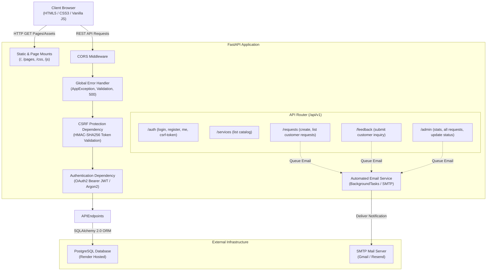

# MrShine Car Wash & Detailing — Architecture Documentation

This document describes the technical architecture, security model, data flows, and modular design of the MrShine management platform.

---

## 1. System Overview



---

## 2. Dedicated Security Architecture (`app/security/`)

The application isolates all security primitives into a dedicated module with explicit exports and FastAPI **Dependency Injection (DI)**:

1. **Password Hashing (`app/security/passwords.py`)**:
   - Uses `pwdlib` with `Argon2Hasher` (`$argon2id$v=19$m=65536...`).
   - Resistant to GPU brute-force attacks and memory-hard.

2. **Access Tokens (`app/security/tokens.py`)**:
   - Cryptographically signed JSON Web Tokens (JWT) using `HS256`.
   - Embeds user identifier (`sub`), role (`role`), and strict expiration (`exp`).

3. **CSRF Protection (`app/security/csrf.py`)**:
   - Generates HMAC-SHA256 tokens using a server-side `CSRF_SECRET_KEY` and timestamp.
   - Enforced on mutating operations (`POST`, `PUT`, `PATCH`, `DELETE`).
   - Delivered via `GET /api/v1/auth/csrf-token` and verified through the `X-CSRF-Token` HTTP header.

4. **Dependency Injection (`app/security/dependencies.py`)**:
   - `get_current_user`: Resolves authenticated customer from Bearer token; rejects deactivated accounts.
   - `get_current_admin`: Ensures authenticated user has `admin` role; returns 403 Forbidden otherwise.
   - `verify_csrf_token`: Verifies token signature before endpoint logic executes.

---

## 3. Global Modular Error Handling (`app/core/errors.py`)

Rather than scattering raw HTTP exceptions, errors are raised and handled centrally:

```python
from app.core.errors import raise_error, NotFoundError, UnauthorizedError

# In any route or service:
if not service:
    raise NotFoundError("Selected service does not exist")

# Or using the shorthand:
raise_error("Invalid email format", status_code=400)
```

The global handler converts all errors into a uniform JSON structure:

```json
{
  "status": "error",
  "code": "NOT_FOUND",
  "detail": "Selected service does not exist",
  "meta": null
}
```

---

## 4. Automated Notifications & Background Tasks

- Email notifications are executed using FastAPI `BackgroundTasks` so HTTP responses remain fast (< 50ms).
- When a customer submits a service request or feedback, the customer receives an immediate confirmation and the administrator receives a detailed alert.
- When an administrator approves or rejects a booking, an automatic status update email is delivered to the customer.
- In development environments with unconfigured SMTP settings, notifications log cleanly without interrupting the user's booking workflow.
