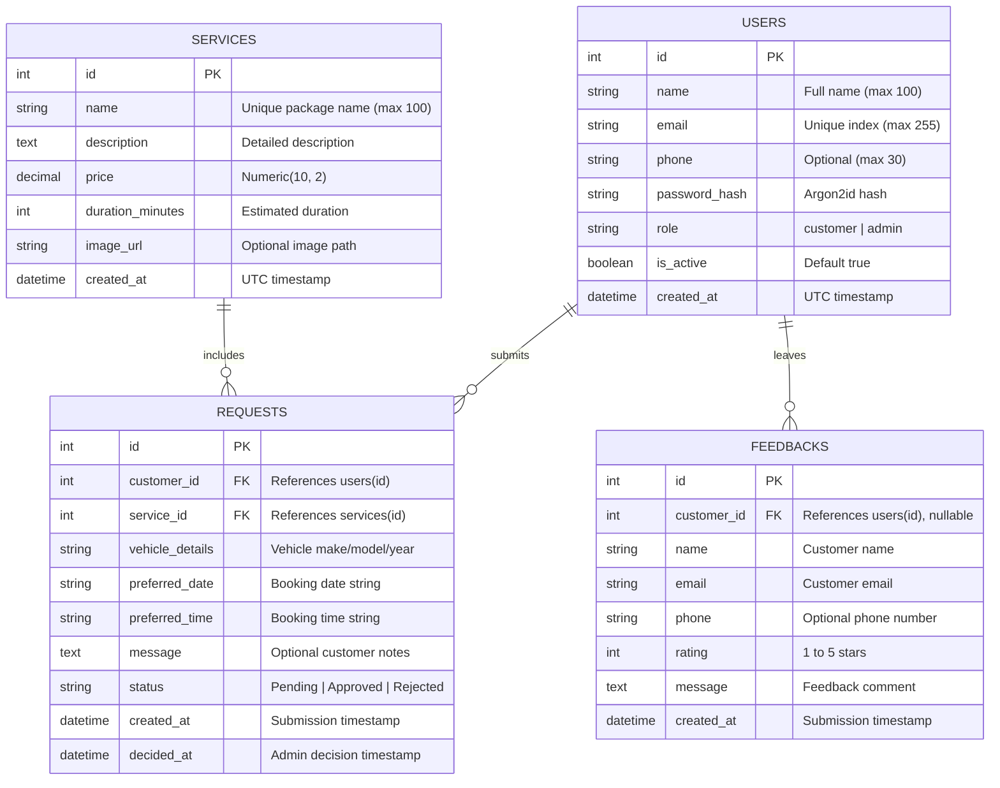

# MrShine Car Wash & Detailing — Database Schema

The database runs on PostgreSQL and is managed using SQLAlchemy 2.0 ORM.

---

## Entity Relationship Diagram

---

## Tables & Schema Specifications

### 1. `users` Table
Stores customer and administrator credentials.
- `id`: `INTEGER`, Primary Key, Autoincrement.
- `name`: `VARCHAR(100)`, Not Null.
- `email`: `VARCHAR(255)`, Not Null, Unique, Indexed.
- `phone`: `VARCHAR(30)`, Nullable.
- `password_hash`: `VARCHAR(255)`, Not Null (Argon2id hash string).
- `role`: `VARCHAR(20)`, Default `'customer'`, Not Null (`'customer'` or `'admin'`).
- `is_active`: `BOOLEAN`, Default `TRUE`, Not Null.
- `created_at`: `TIMESTAMP WITH TIME ZONE`, Default `NOW()`, Not Null.

### 2. `services` Table
Stores standard car care packages offered by MrShine.
- `id`: `INTEGER`, Primary Key, Autoincrement.
- `name`: `VARCHAR(100)`, Not Null, Unique.
- `description`: `TEXT`, Nullable.
- `price`: `NUMERIC(10, 2)`, Not Null.
- `duration_minutes`: `INTEGER`, Default `60`, Not Null.
- `image_url`: `VARCHAR(255)`, Nullable.
- `created_at`: `TIMESTAMP WITH TIME ZONE`, Default `NOW()`, Not Null.

### 3. `requests` Table
Tracks booking requests submitted by customers and reviewed by administrators.
- `id`: `INTEGER`, Primary Key, Autoincrement.
- `customer_id`: `INTEGER`, Not Null, Foreign Key references `users(id)` ON DELETE CASCADE.
- `service_id`: `INTEGER`, Not Null, Foreign Key references `services(id)` ON DELETE RESTRICT.
- `vehicle_details`: `VARCHAR(255)`, Not Null.
- `preferred_date`: `VARCHAR(50)`, Not Null.
- `preferred_time`: `VARCHAR(50)`, Not Null.
- `message`: `TEXT`, Nullable.
- `status`: `VARCHAR(20)`, Default `'Pending'`, Not Null (`'Pending'`, `'Approved'`, `'Rejected'`).
- `created_at`: `TIMESTAMP WITH TIME ZONE`, Default `NOW()`, Not Null.
- `decided_at`: `TIMESTAMP WITH TIME ZONE`, Nullable.

### 4. `feedbacks` Table
Stores ratings, reviews, and general contact inquiries from customers.
- `id`: `INTEGER`, Primary Key, Autoincrement.
- `customer_id`: `INTEGER`, Nullable, Foreign Key references `users(id)` ON DELETE SET NULL.
- `name`: `VARCHAR(100)`, Not Null.
- `email`: `VARCHAR(255)`, Not Null.
- `phone`: `VARCHAR(30)`, Nullable.
- `rating`: `INTEGER`, Default `5`, Not Null (constrained 1 to 5).
- `message`: `TEXT`, Not Null.
- `created_at`: `TIMESTAMP WITH TIME ZONE`, Default `NOW()`, Not Null.
